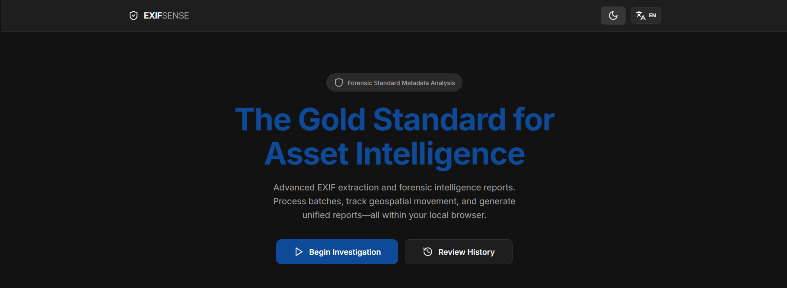

# ExifSense

## EXIF Image Metadata, Made Easy for Everyone

ExifSense is a browser-native tool that translates raw image metadata, camera settings, and geolocation tags into clear, human-readable insights. Designed to reduce technical complexity and lower the barrier of understanding, ExifSense helps photographers, privacy-conscious users, and curious individuals understand the data behind their photos—without sending a single byte to the cloud.

> "Standard EXIF viewers provide raw data lists. ExifSense provides clarity and context."



---

## Quick Start

No installation, account creation, or server deployment is required.

1. **Clone or Download** this repository.
2. **Open** `index.html` in any modern web browser.
3. **Drag & Drop** your images to view detailed metadata and insights immediately.

---

## Key Benefits

### Human-Readable Insights (Cognitive Reducer)
Raw EXIF data often consists of obscure technical parameters such as aperture, exposure bias, and focal length. ExifSense automatically analyzes these attributes and presents them in plain, accessible language—explaining lighting conditions, lens choices, and capture history without requiring deep technical knowledge.

### Complete Local Privacy (Zero-Server Architecture)
Your photos and metadata remain entirely on your device. Extraction, narrative generation, mapping, and metadata removal are performed 100% locally in your browser to guarantee complete data confidentiality.

### Geospatial and Travel Route Visualization
Visualize photo capture locations on interactive maps. For collections taken across multiple locations, ExifSense reconstructs plausible road-following movement paths to help you trace travel journeys.

### One-Click Privacy Shield
Remove sensitive GPS coordinates, device identifiers, and metadata tags prior to sharing photos online, protecting personal privacy while maintaining original asset quality.

### Software Modification Detection
Identify post-processing signatures from common image editing software, timestamp discrepancies, and file extension mismatches to evaluate asset integrity.

---

## Core Features

| Feature | Description |
| :--- | :--- |
| **Single Image Analysis** | Detailed breakdown of camera hardware, optical settings, date history, and exact location. |
| **Batch Comparison** | Inspect multiple files simultaneously with side-by-side technical correlation and combined map views. |
| **CLI Analysis & Simulation** | Terminal-native execution harness for headless analysis, automated testing, and simulated edge-case presets. |
| **Metadata Sanitization** | Selective or full removal of EXIF metadata categories with instant cleaned file downloads. |
| **Interactive Mapping** | High-fidelity map rendering with reverse geocoding to display physical addresses. |
| **Export Capability** | Export comprehensive reports as PDF, Markdown, CSV, or structured JSON data manifests. |
| **Multi-Language Support** | Full localization in English, Bahasa Indonesia, and Arabic (RTL layout supported). |

---

## Command-Line Interface (CLI)

ExifSense includes a standalone, terminal-native CLI executable (`exifsense`) that runs single-asset and batch forensic analyses directly from your shell, completely bypassing the browser interface. It allows developers and investigators to analyze real images, extract raw EXIF metadata, and run version-controlled simulation scenarios.

### Setup

To build and register the command globally:

```bash
npm install
npm run build:cli
npm link
```

### Usage

```bash
# Analyze a single photo or JSON metadata file
exifsense single photo.jpg

# Analyze multiple photos and generate collective intelligence and chronological story
exifsense batch photo1.jpg photo2.jpg photo3.jpg

# Run a pre-configured simulation scenario from disk
exifsense scenario travel-sequence

# Extract raw EXIF metadata into a clean JSON file
exifsense extract photo.jpg metadata.json

# Format output as Markdown or write directly to a file
exifsense scenario time-jump-anomaly --format markdown --out report.md

# Switch narrative language (en, id, ar)
exifsense single photo.jpg --locale id
```

### Simulation Scenarios

Curated test scenarios are stored as version-controlled JSON files in `tests/fixtures/scenarios/`. These allow reproducible testing of edge cases without checking bulky image binaries into Git:

* `baseline`: Clean metadata extracted from real-world geotagged photos.
* `missing-gps`: Evaluates integrity alerts when GPS coordinates are omitted.
* `missing-datetime`: Evaluates timeline fallbacks when capture dates are missing.
* `missing-device`: Evaluates hardware fallbacks when camera make and model are stripped.
* `tampered-software`: Simulates third-party editing tags (such as Photoshop or GIMP).
* `travel-sequence`: Multi-asset movement sequence generating a step-by-step travel story.
* `time-jump-anomaly`: Multi-asset sequence simulating an artificial multi-day break between photos.
* `hardware-discrepancy`: Multi-asset sequence simulating a camera model switch midway through a trip.

---

## Target Use Cases

* **Photographers & Enthusiasts**: Review camera settings, lens performance, and exposure metrics across shooting sessions.
* **Privacy-Conscious Individuals**: Strip sensitive location and device identifiers before publishing photos to public channels.
* **Travelers**: Map past journeys and visualize geographic movements through geotagged photos.
* **Content Creators**: Verify photo authenticity, check for post-processing edits, and inspect source metadata.

---

## Architecture & Technology

ExifSense is built with a lightweight, modular vanilla JavaScript architecture designed for high performance and long-term maintainability without framework overhead.

* **EXIF Engine**: [Exifr](https://github.com/MikeKroz/exifr) for multi-format metadata parsing (JPEG, TIFF, HEIC, DNG, RAW).
* **Geospatial Mapping**: [Leaflet.js](https://leafletjs.com/) with OSRM road-routing and Nominatim reverse geocoding.
* **Document Generation**: [jsPDF](https://github.com/parallax/jsPDF) with `jspdf-autotable` for structured reporting.
* **Storage & State**: Browser-native `localStorage` for session history and zero-server state persistence.

---

## License

Distributed under the MIT License. See `LICENSE` for more information.


