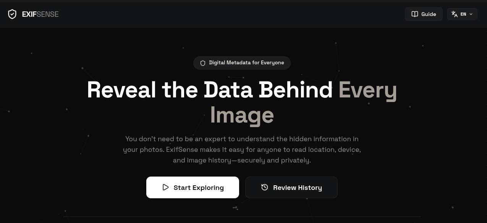

# ExifSense

## EXIF Image Metadata, Made Easy for Everyone

ExifSense is a browser-native tool that translates raw image metadata, camera settings, and geolocation tags into clear, human-readable insights. Designed to reduce technical complexity and lower the barrier of understanding, ExifSense helps photographers, privacy-conscious users, and curious individuals understand the data behind their photos—without sending a single byte to the cloud.

> "Standard EXIF viewers provide raw data lists. ExifSense provides clarity and context."



---

## Quick Start

No installation, account creation, or server deployment is required.

1. **Clone or Download** this repository.
2. **Open** `index.html` in any modern web browser.
3. **Drag & Drop** your images to view detailed metadata and insights immediately.

---

## Key Benefits

### Human-Readable Insights (Cognitive Reducer)
Raw EXIF data often consists of obscure technical parameters such as aperture, exposure bias, and focal length. ExifSense automatically analyzes these attributes and presents them in plain, accessible language—explaining lighting conditions, lens choices, and capture history without requiring deep technical knowledge.

### Complete Local Privacy (Zero-Server Architecture)
Your photos and metadata remain entirely on your device. Extraction, narrative generation, mapping, and metadata removal are performed 100% locally in your browser to guarantee complete data confidentiality.

### Geospatial and Travel Route Visualization
Visualize photo capture locations on interactive maps. For collections taken across multiple locations, ExifSense reconstructs plausible road-following movement paths to help you trace travel journeys.

### One-Click Privacy Shield
Remove sensitive GPS coordinates, device identifiers, and metadata tags prior to sharing photos online, protecting personal privacy while maintaining original asset quality.

### Software Modification Detection
Identify post-processing signatures from common image editing software, timestamp discrepancies, and file extension mismatches to evaluate asset integrity.

---

## Core Features

| Feature | Description |
| :--- | :--- |
| **Single Image Analysis** | Detailed breakdown of camera hardware, optical settings, date history, and exact location. |
| **Batch Comparison** | Inspect multiple files simultaneously with side-by-side technical correlation and combined map views. |
| **Command-Line Interface** | Terminal-native execution harness for headless single-image, batch, hash, and EXIF extraction workflows. |
| **Forensic Hash Inspection** | Instant SHA-256 and SHA-1 calculation across single files, batches, or directories for non-destructive verification. |
| **Metadata Sanitization** | Selective or full removal of EXIF metadata categories with instant cleaned file downloads. |
| **Interactive Mapping** | High-fidelity map rendering with reverse geocoding to display physical addresses. |
| **Export Capability** | Export comprehensive reports as PDF, Markdown, CSV, or structured JSON data manifests. |
| **Multi-Language Support** | Full localization in English and Bahasa Indonesia. |

---

## Command-Line Interface (CLI)

ExifSense includes a standalone, terminal-native CLI executable (`exifsense`) that runs single-asset and batch forensic analyses directly from your shell with 1:1 output parity to the Web dashboard, completely bypassing the browser interface. When online, single and batch runs automatically enrich GPS coordinates with physical addresses via Nominatim reverse geocoding (sequentially paced for batches) and estimate driving distances via OSRM, falling back cleanly to numeric coordinates when offline.

### Setup

Install the standalone CLI package globally without the web application:

```bash
npm install -g exifsense-cli
```

Or run it directly without installing globally:

```bash
npx --package=exifsense-cli exifsense --help
```

Or build and link from source:

```bash
npm install
npm run build:cli
npm link
```

### Usage

```bash
# Analyze a single photo or JSON metadata file (hashes, alerts, 7 narratives, 8 EXIF categories)
exifsense single photo.jpg

# Inspect cryptographic hashes (SHA-256 & SHA-1) across files or directories
exifsense hash photo1.jpg photo2.jpg
exifsense hash path/to/folder/ --format markdown --out manifest.md

# Analyze multiple photos (Alerts, Chronological Story, and 4 Combined Analysis evidence views)
exifsense batch photo1.jpg photo2.jpg photo3.jpg

# Include full per-asset single-file breakdowns at the end of a batch report
exifsense batch photo1.jpg photo2.jpg --detailed

# Extract raw EXIF metadata into a clean JSON file
exifsense extract photo.jpg metadata.json

# Format output as Markdown in Indonesian and write directly to a file
exifsense batch photo1.jpg photo2.jpg --locale id --format markdown --detailed --out report.md
```

### Options

| Flag | Description | Default |
| :--- | :--- | :--- |
| `--locale <en\|id>` | Narrative and table language (`en` or `id`) | `en` |
| `--format <plain\|markdown>` | Output rendering format (`plain` text or `markdown`) | `plain` |
| `--detailed` | Append individual single-asset breakdowns (`exifsense single` output) to batch reports | `false` |
| `--out <path>` | Write output directly to a file instead of standard output | stdout |

### Output Structure

* **Single Analysis (`single`)**: Displays file metadata with SHA-256 and SHA-1 hashes, Integrity Alerts, all 7 Forensic Narrative sections, and all 8 Categorized EXIF Metadata groups.
* **Batch Analysis (`batch`)**: Follows the Web dashboard order with `Total Assets`, `Asset Integrity Alerts` (when anomalies exist), `Chronological Story`, and `Combined Analysis` (Integrity Matrix, 7-column Hardware Comparison table, Timeline bounds and gaps, and Geospatial metrics with adaptive `m`/`km` distances and road-route estimates).
* **Detailed Batch Mode (`--detailed`)**: Preserves the full batch summary above and appends `Individual Asset Analysis` (`ASSET 1` through `ASSET N`) in input order using single-asset formatting.

---

## Target Use Cases

* **Photographers & Enthusiasts**: Review camera settings, lens performance, and exposure metrics across shooting sessions.
* **Privacy-Conscious Individuals**: Strip sensitive location and device identifiers before publishing photos to public channels.
* **Travelers**: Map past journeys and visualize geographic movements through geotagged photos.
* **Content Creators**: Verify photo authenticity, check for post-processing edits, and inspect source metadata.

---

## Architecture & Technology

ExifSense is built with a lightweight, modular vanilla JavaScript architecture designed for high performance and long-term maintainability without framework overhead.

* **EXIF Engine**: [Exifr](https://github.com/MikeKroz/exifr) for multi-format metadata parsing (JPEG, TIFF, HEIC, DNG, RAW).
* **Geospatial Mapping**: [Leaflet.js](https://leafletjs.com/) with OSRM road-routing and Nominatim reverse geocoding.
* **Document Generation**: [jsPDF](https://github.com/parallax/jsPDF) with `jspdf-autotable` for structured reporting.
* **Storage & State**: Browser-native `localStorage` for session history and zero-server state persistence.

---

## License

Distributed under the MIT License. See `LICENSE` for more information.


