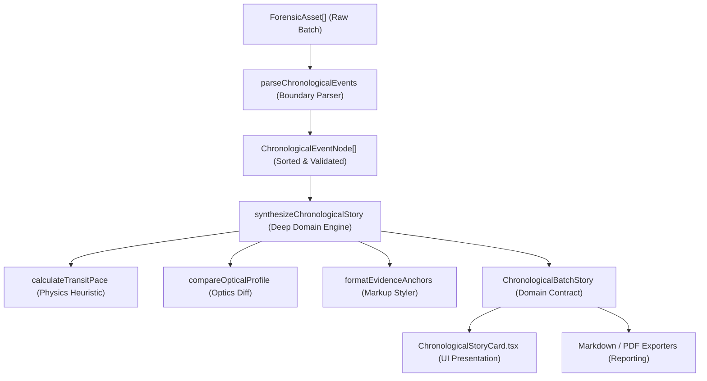

# Blueprint: Chronological Batch Narrative

## Codebase Context & Reality Check

ExifSense currently processes multi-asset batches via `evaluateCollectiveIntelligence` in `src/core/forensics/collective.ts` and renders narrative output via `generateCollectiveNarratives` in `src/core/narratives/narratives.ts`. The UI displays this inside `CombinedIntelligenceCard` in `src/components/dashboard/CombinedIntelligenceCard.tsx`.

Today's implementation suffers from two architectural limitations:
1. Fragmented Domain Silos: Findings are split across four separate tabs (`Digital Integrity`, `Device Hardware`, `Timeline & Date`, `Geospatial`). The user is forced to switch tabs to read about camera models vs time spans vs distance.
2. Static Aggregate Metrics: The narrative generator in `narratives.ts` interpolates single-sentence locale templates that describe batch-wide sums (e.g. "All photos were taken within a span of 1.5 hours" or "Location spread shows the photographer traveled about 1.5 km"). It never recounts the chronological journey connecting image N to image N-1.

While `collective.ts` already calculates pairwise differences (`TimelineJump` and `GeospatialJump`), those numbers are exposed only in raw tables. There is no synthesis engine that combines elapsed time, distance, transit pace, and optical changes into an unfolding story.

## System Architecture & Domain Boundaries

The chronological batch narrative is encapsulated as a deep domain module within `src/core/narratives/chronological.ts` and exposed to the UI via a dedicated presentation component `src/components/dashboard/ChronologicalStoryCard.tsx`.



### Locality of Behavior & AHA Compliance
- All pairwise calculations, transit heuristics, and chronological narrative formatting live inside `src/core/narratives/chronological.ts`.
- We avoid premature abstractions: no generic `StoryGenerator` interface or dynamic plugin architecture. The module directly solves chronological batch reconstruction for EXIF images.
- Existing components (`CombinedIntelligenceCard`, `AssetPreviewCard`, `ExpertAnalysisTabs`) remain completely untouched in `DashboardView.tsx`. The new `ChronologicalStoryCard` renders additively above `CombinedIntelligenceCard` when `assets.length > 1`.

## Public API & Interface Contracts

### BP-NARRATIVE-001: Chronological Event Parsing & Sorting
- Function: `parseChronologicalEvents(assets: ForensicAsset[]): ChronologicalEventNode[]`
- Input: An array of `ForensicAsset` objects (minimum length: 2).
- Boundary Validation:
  - If `assets.length < 2`, throw a descriptive error (`"Chronological narrative requires at least 2 assets"`).
  - Extract capture timestamp from `exifData.DateTimeOriginal`, `CreateDate`, or `DateTime`. If missing, mark `hasCaptureTime: false` and fall back to `fileDate` for relative sorting.
  - Extract GPS coordinates (`latitude`, `longitude`). If NaN or missing, mark `hasGps: false`.
- Execution: Sorts assets chronologically by resolved timestamp in ascending order.
- Outcome: Returns an immutable, strongly-typed array of `ChronologicalEventNode` items.
- Unhappy Paths: If an asset contains malformed or unparseable metadata fields, the parser gracefully flags that property as missing (`hasGps: false`, `hasDevice: false`) without throwing.

### BP-NARRATIVE-002: Transit Pace & Physical Heuristics
- Function: `evaluateTransitPace(distanceMeters: number, elapsedSeconds: number): TransitInference`
- Input:
  - `distanceMeters`: positive number representing Haversine distance between two points.
  - `elapsedSeconds`: positive number representing elapsed time between two captures.
- Execution:
  - Calculate velocity: `speedKmh = (distanceMeters / 1000) / (elapsedSeconds / 3600)`.
  - Guard clauses categorize the physical movement:
    - If `distanceMeters < 50`: returns `'stationary'` (immediate vicinity).
    - If `distanceMeters >= 50` and `speedKmh <= 6`: returns `'walking'` (movement on foot).
    - If `distanceMeters >= 200` and `speedKmh > 15` and `speedKmh <= 150`: returns `'motorized'` (mobile or vehicular transit).
    - If `speedKmh > 800`: returns `'air_or_anomaly'` (high-speed air transit or clock discrepancy).
    - Otherwise: returns `'transition'` (general movement).
- Outcome: Returns `{ speedKmh: number, mode: TransitMode, descriptionKey: string }`.
- Unhappy Paths: If `elapsedSeconds <= 0` while `distanceMeters > 50`, flags an instant jump anomaly (`speedKmh: 999999`, mode: `'anomaly'`).

### BP-NARRATIVE-003: Sequential Narrative Synthesis Engine
- Function: `generateChronologicalBatchStory(assets: ForensicAsset[], options?: ChronologicalStoryOptions): ChronologicalBatchStory`
- Options:
  - `locale`: SupportedLocale (`'en'` | `'id'` | `'ar'`), defaults to `'en'`.
  - `format`: `'html'` | `'markdown'` | `'plain'`, defaults to `'html'`.
- Execution Flow:
  1. Calls `parseChronologicalEvents(assets)`.
  2. Generates the baseline sentence: checks if all assets share the same `Make` and `Model`. If identical, states single-device baseline; if different, lists observed devices without speculative guesses.
  3. Iterates through sorted nodes:
     - For index 0 (initial photo): narrates filename, location, capture date/time, and initial lens profile.
     - For index `i > 0` (subsequent photos): compares against node `i - 1`. Computes elapsed time, Haversine distance, transit pace inference, location status, and optical changes (lens model or focal length differences).
     - Missing metadata handling: if GPS is absent on node `i`, narrates that location was not recorded rather than omitting the event.
  4. Formats factual evidence tokens (filenames, timestamps, distances, speeds, devices) with distinct highlight styling:
     - HTML format: `<span class="evidence-highlight">[value]</span>`
     - Markdown format: `**[value]**`
     - Plain format: `[value]`
- Outcome: Returns `ChronologicalBatchStory` containing `baseline`, array of `steps`, and combined `fullNarrative`.
- Unhappy Paths: If `assets.length < 2`, throws descriptive error without side effects.

### BP-UI-001: Chronological Story Card Component
- Component: `src/components/dashboard/ChronologicalStoryCard.tsx`
- Props:
  - `assets: ForensicAsset[]`
  - `onInspectAsset?: (assetIndex: number) => void`
- Execution:
  - Renders when `assets.length > 1`.
  - Calls `generateChronologicalBatchStory(assets, { locale: currentLang, format: 'html' })`.
  - Displays the baseline statement in a prominent lead paragraph.
  - Displays sequential transition paragraphs with highlighted evidence spans.
  - Provides a clean copy-story button to copy the narrative as markdown or plain text to the clipboard.
- Styling: Conforms to `docs/design/brand.md`: obsidian surface background (`--bg-card`), Space Grotesk typography, subtle warm stone evidence badge highlights (`rgba(229, 224, 216, 0.1)` with warm text `#e5e0d8`).

## Data Representation & Storage

```typescript
export type TransitMode =
  | 'stationary'
  | 'walking'
  | 'motorized'
  | 'air_or_anomaly'
  | 'transition'
  | 'unknown';

export interface ChronologicalEventNode {
  assetIndex: number;
  fileName: string;
  timestamp: Date;
  hasCaptureTime: boolean;
  latitude: number | null;
  longitude: number | null;
  hasGps: boolean;
  make: string;
  model: string;
  deviceString: string;
  lensModel: string | null;
  focalLength: string | null;
  fNumber: string | null;
  iso: string | null;
}

export interface ChronologicalStoryStep {
  stepIndex: number;
  assetIndex: number;
  fileName: string;
  narrativeText: string;
  evidence: {
    formattedDate?: string;
    elapsedTimeString?: string;
    distanceMeters?: number;
    distanceString?: string;
    transitMode?: TransitMode;
    locationName?: string;
    deviceString: string;
    deviceChanged: boolean;
    lensString?: string;
    lensChanged: boolean;
  };
}

export interface ChronologicalBatchStory {
  baseline: string;
  steps: ChronologicalStoryStep[];
  fullNarrative: string;
}

export interface ChronologicalStoryOptions {
  locale?: 'en' | 'id' | 'ar';
  format?: 'html' | 'markdown' | 'plain';
}
```

## Directives Compliance & Verification Strategy

### Compliance Highlights
- AHA > DRY: We build one cohesive narrative generator in `src/core/narratives/chronological.ts`. We do not create premature base classes or strategy registries.
- Deep Modules & Locality of Behavior: The public API consists of one primary function `generateChronologicalBatchStory`. All intermediate steps (boundary parsing, pairwise distance math, pace heuristics, optical diffing) are encapsulated inside the module.
- Parse, Don't Validate: `parseChronologicalEvents` parses raw `ForensicAsset` structures into guaranteed, non-nullable types (`hasGps: boolean`, `timestamp: Date`). Downstream generator logic trusts these types without defensive `typeof` checks.
- Fail Fast & Loud: Explicit error thrown when `assets.length < 2`. No silent null-coalescing fallbacks on invalid coordinates.
- Boring is Good: Flat execution flow using guard clauses. Maximum indentation level is 2. No boolean flags in function signatures; options are passed via `ChronologicalStoryOptions`.

### Verification Strategy (Ready for /proof)
1. `BP-NARRATIVE-001` (Parsing & Sorting):
   - Automated unit test via Vitest (`tests/core/narratives/chronological.test.ts`).
   - Verifies that out-of-order timestamps are sorted in chronological sequence, and missing timestamps fall back to file dates with `hasCaptureTime: false`.
2. `BP-NARRATIVE-002` (Transit Pace Heuristics):
   - Automated unit test verifying pace calculations across stationary (<50m), walking (<6 km/h), motorized (>15 km/h), and anomaly (>800 km/h) scenarios.
3. `BP-NARRATIVE-003` (Narrative Synthesis):
   - Automated unit test verifying three-image test fixtures matching user requirements:
     - All on same device -> verifies baseline text.
     - Image 1 at Location A.
     - Image 2 taken 30 minutes later, 1,200m away -> verifies transit inference "suggests mobile transportation".
     - Image 3 taken 5 minutes later, 50m away with different lens -> verifies optical change detection.
     - Multiple device fixture -> verifies device change text without sociological guessing.
     - Missing GPS fixture -> verifies natural gap degradation text.
     - Multi-language verification for `'en'`, `'id'`, and `'ar'`.
4. `BP-UI-001` (UI Presentation):
   - Component rendering test and visual verification in `DashboardView.tsx` ensuring evidence anchors are subtly highlighted and layout matches brand design.
