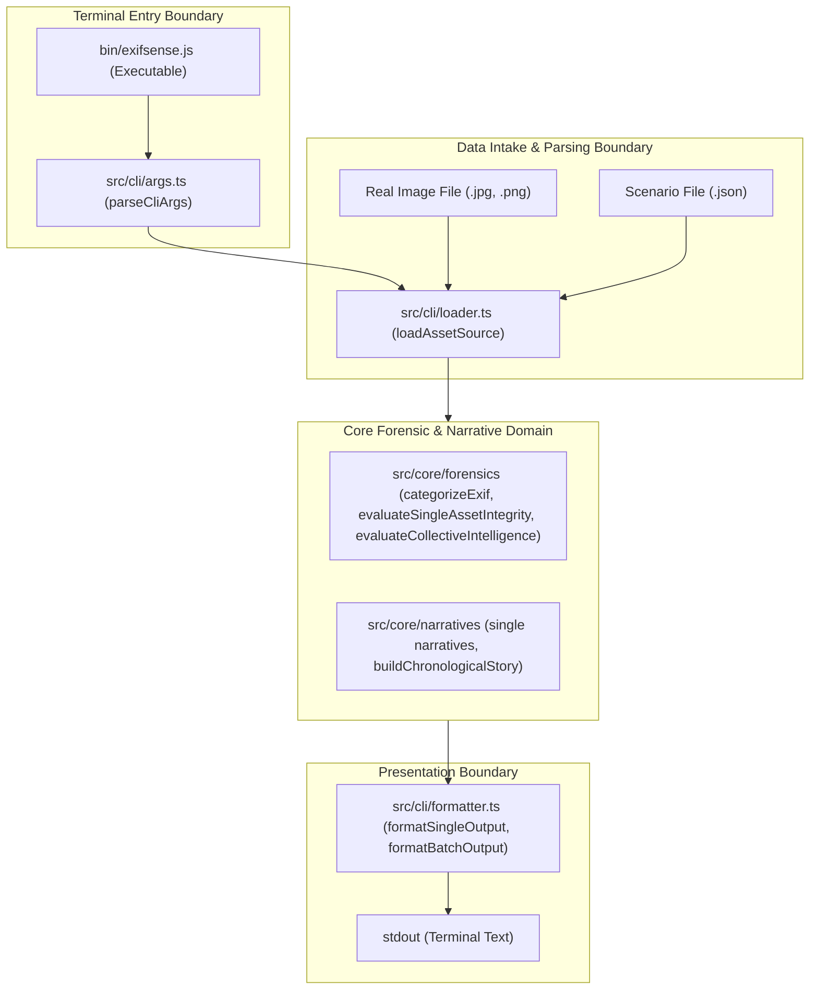

# Blueprint: CLI Analysis and Simulation Harness

## Codebase Context & Reality Check

ExifSense's core forensic and narrative engines reside in `src/core/`:
- `src/core/forensics/metadata.ts`: `categorizeExif()` maps raw EXIF key-values into 8 standard forensic categories.
- `src/core/forensics/integrity.ts`: `evaluateSingleAssetIntegrity()` generates `IntegrityAlert` items (e.g. `fully_stripped`, `missing_gps`, `editing_software`, `future_capture_date`).
- `src/core/forensics/collective.ts`: `evaluateCollectiveIntelligence()` calculates multi-asset device consistency, timeline intervals, and geospatial distance jumps.
- `src/core/narratives/narratives.ts`: Generates plain-text single-asset narratives (hardware, integrity, exposure, optics, quality, timeline, geospatial) and collective summaries.
- `src/core/narratives/chronological.ts`: `buildChronologicalStory()` generates step-by-step travelogue narratives from chronological event nodes.

Currently, the only execution bridge to these core functions is through browser UI components and `src/services/ingestionCoordinator.ts`, which requires DOM `File` objects from drag-and-drop events and writes into Zustand stores (`useAssetStore`).

To satisfy the target Intent (`docs/intent/20261102_cli_analysis_simulation.md`), we must provide an independent, headless execution path that can run from any terminal directory, parse real image files or arbitrary JSON metadata snapshots, execute the core engines, and output human-readable narrative text and integrity alerts directly to standard output.

## System Architecture & Domain Boundaries

The CLI harness consists of four cohesive, single-responsibility modules under `src/cli/`, alongside a lightweight standalone executable entry point in `bin/exifsense.js`:



### Module Boundaries

1. **`src/cli/args.ts`**: Pure argument parser using Node's native `node:util.parseArgs`. Validates flags, commands, and target paths at the entry boundary. Fails fast with clean exit codes.
2. **`src/cli/loader.ts`**: Deep loader module. Reads files from arbitrary filesystem paths (relative or absolute). If given an image, extracts EXIF via `exifr`. If given a JSON file, parses structured metadata. Constructs trusted `ForensicAsset` instances.
3. **`src/cli/formatter.ts`**: Transforms raw forensic results and narrative strings into structured, readable plain-text terminal output.
4. **`src/cli/runner.ts`**: Orchestrates argument parsing, data intake, core engine execution, and formatting.
5. **`tests/fixtures/scenarios/`**: Version-controlled JSON scenario fixtures representing baseline metadata (from `Downloads/archive/`) and curated edge cases (missing GPS, missing timestamps, edited software, multi-device discrepancies).

## Public API & Interface Contracts

### BP-CLI-001: CLI Argument Parsing (`parseCliArgs`)
- **Module**: `src/cli/args.ts`
- **Signature**: `parseCliArgs(rawArgs: string[]): CliParsedCommand`
- **Inputs & Preconditions**:
  - `rawArgs`: Array of string arguments (typically `process.argv.slice(2)`).
- **Execution Behavior**:
  - Uses `node:util.parseArgs` with strict option schemas.
  - Recognizes commands: `single`, `batch`, `scenario`, `extract`, `--help`, `--version`.
  - Recognizes options: `--locale` (`en` | `id` | `ar`, default `en`), `--format` (`plain` | `markdown`, default `plain`), `--out` (string path).
- **Returned Outcomes**:
  - Discriminated union `CliParsedCommand`:
    - `{ command: 'single', targetPath: string, options: CliOptions }`
    - `{ command: 'batch', targetPaths: string[], options: CliOptions }`
    - `{ command: 'scenario', scenarioName: string, options: CliOptions }`
    - `{ command: 'extract', sourcePath: string, outputPath?: string }`
    - `{ command: 'help' }`
- **Unhappy Paths**:
  - Unknown command or missing required file arguments: throws `CliArgumentError` with clear usage guidance and exits with code 1.

### BP-CLI-002: Universal Asset Loader (`loadAssetSource`)
- **Module**: `src/cli/loader.ts`
- **Signature**: `loadAssetSource(resolvedPath: string): Promise<ForensicAsset>`
- **Inputs & Preconditions**:
  - `resolvedPath`: Valid absolute filesystem path to an image file or a `.json` metadata file.
- **Execution Behavior**:
  - Checks file existence using `fs.promises.stat`.
  - If `.json`: parses JSON content, validates required fields, and maps to `ForensicAsset`.
  - If binary image (`.jpg`, `.jpeg`, `.png`, `.tiff`, `.heic`): reads file buffer, parses EXIF tags via `exifr`, computes SHA-256 and SHA-1 hashes via Web Crypto, and produces a complete `ForensicAsset`.
- **Returned Outcomes**:
  - Valid, fully-populated `ForensicAsset` ready for core engine processing.
- **Unhappy Paths**:
  - File not found: throws descriptive `FileNotFoundError`.
  - Corrupt or invalid JSON: throws `InvalidJsonError` with parsing details.
  - Corrupt or unparseable image signature: throws `UnsupportedFormatError`.

### BP-CLI-003: Preset Scenario Resolver (`resolveScenario`)
- **Module**: `src/cli/loader.ts`
- **Signature**: `resolveScenario(scenarioName: string): Promise<ForensicAsset | ForensicAsset[]>`
- **Inputs & Preconditions**:
  - `scenarioName`: Identifier matching a file in `tests/fixtures/scenarios/` (e.g. `missing-gps`, `travel-sequence`).
- **Execution Behavior**:
  - Maps scenario name to `tests/fixtures/scenarios/${scenarioName}.json`.
  - If JSON contains an array of assets, returns `ForensicAsset[]` for batch processing.
  - If JSON contains a single asset object, returns a single `ForensicAsset`.
- **Unhappy Paths**:
  - Unknown scenario name: throws `ScenarioNotFoundError` listing all available scenario presets.

### BP-CLI-004: Execution Runner (`runCli`)
- **Module**: `src/cli/runner.ts`
- **Signature**: `runCli(argv: string[]): Promise<CliExecutionResult>`
- **Inputs & Preconditions**:
  - `argv`: String array of command arguments.
- **Execution Behavior**:
  - Parses arguments via `parseCliArgs` (BP-CLI-001).
  - Routes to appropriate handler (`executeSingle`, `executeBatch`, `executeScenario`, `executeExtract`).
  - Executes core forensic functions (`categorizeExif`, `evaluateSingleAssetIntegrity`, `evaluateCollectiveIntelligence`).
  - Executes core narrative generators (`generateHardwareNarrative`, `generateExposureNarrative`, `buildChronologicalStory`).
  - Passes results to `formatter.ts` and writes to `process.stdout`.
- **Returned Outcomes**:
  - `{ success: true, exitCode: 0, outputText: string }`
- **Unhappy Paths**:
  - Catches domain errors, formats user-facing error message to `process.stderr`, and returns `{ success: false, exitCode: 1, errorText: string }`.

### BP-CLI-005: Baseline Extraction (`extractBaseline`)
- **Module**: `src/cli/loader.ts`
- **Signature**: `extractBaseline(sourceImagePath: string, destinationJsonPath?: string): Promise<Record<string, unknown>>`
- **Inputs & Preconditions**:
  - `sourceImagePath`: Path to real photo (e.g. `Downloads/archive/000-099/000.jpg`).
- **Execution Behavior**:
  - Reads image buffer and extracts complete EXIF tag dictionary using `exifr.parse(buffer, true)`.
  - Serializes to formatted JSON.
  - If `destinationJsonPath` is specified, writes to disk; otherwise outputs to stdout.
- **Returned Outcomes**:
  - Raw metadata dictionary object.

## Data Representation & Storage

### Scenario Fixture Structure (`tests/fixtures/scenarios/`)
Scenarios are stored as version-controlled JSON files. A single-asset scenario follows this schema:

```json
{
  "fileName": "sample_baseline.jpg",
  "fileSize": 987375,
  "fileDate": 1552966548000,
  "exifData": {
    "Make": "LGE",
    "Model": "Nexus 5X",
    "DateTimeOriginal": "2019-03-19T03:35:48.000Z",
    "latitude": 55.86449,
    "longitude": -4.42989,
    "FocalLength": 4.67,
    "FNumber": 2.0,
    "ExposureTime": 0.0083,
    "ISO": 60
  }
}
```

A batch scenario is a JSON array of such objects, capturing consecutive events across a timeline.

### Curated Scenarios Catalog
1. `tests/fixtures/scenarios/baseline.json`: Clean, complete metadata extracted from `Downloads/archive/000-099/000.jpg`.
2. `tests/fixtures/scenarios/single/missing-gps.json`: Baseline with `latitude` and `longitude` omitted.
3. `tests/fixtures/scenarios/single/missing-datetime.json`: Baseline with `DateTimeOriginal`, `CreateDate`, and `DateTime` omitted.
4. `tests/fixtures/scenarios/single/missing-device.json`: Baseline with `Make` and `Model` omitted.
5. `tests/fixtures/scenarios/single/tampered-software.json`: Baseline with `Software: "Adobe Photoshop 2024"`.
6. `tests/fixtures/scenarios/batch/travel-sequence.json`: 5 consecutive photos from Scotland simulating movement and chronological story steps.
7. `tests/fixtures/scenarios/batch/time-jump-anomaly.json`: 5 photos with an artificial 72-hour jump between photos 2 and 3.
8. `tests/fixtures/scenarios/batch/hardware-discrepancy.json`: 5 photos where photo 3 switches camera hardware.

## Directives Compliance & Verification Strategy

### Engineering Directives Compliance
1. **AHA > DRY**: Solves immediate CLI and simulation needs directly without creating abstract command frameworks, plugin loaders, or generic runner hierarchies.
2. **Deep Modules & Locality of Behavior**: All CLI parsing, loading, formatting, and running logic lives compactly inside `src/cli/`. Public signature `runCli(argv)` encapsulates the entire execution flow.
3. **Parse, Don't Validate**: Boundaries validate inputs immediately: `parseCliArgs` parses raw argv into typed command unions; `loadAssetSource` validates file existence and formats before yielding trusted `ForensicAsset` objects to core logic.
4. **Fail Fast and Loud**: Clear exit code 1 and descriptive error messages for missing files, invalid JSON, or unparseable images. No silent swallowing of errors.
5. **Boring & Readable**: Built using standard Node `node:util.parseArgs` and `fs.promises`. No boolean flags in function signatures; options are passed via typed configuration objects. Guard clauses ensure maximum 2 levels of indentation.
6. **No Production Test Pollution**: Scenarios and fixtures remain strictly in `tests/fixtures/scenarios/`.

### Verification Strategy (for `/proof`)
- **Automated Behavioral Tests (`tests/cli/cli.test.ts`)**:
  - `BP-CLI-001`: Verify argument parsing across normal commands (`single`, `batch`, `scenario`), missing argument errors, and `--help` flag.
  - `BP-CLI-002`: Verify loading both real image buffers and JSON scenario fixtures into valid `ForensicAsset` instances.
  - `BP-CLI-003`: Verify resolving all preset scenarios and rejecting non-existent scenario names.
  - `BP-CLI-004`: End-to-end execution of `runCli()` for single asset narratives, batch collective stories, and edge-case integrity alerts.
  - `BP-CLI-005`: Verify extracting baseline metadata from a real image file into clean JSON.
- **Manual Live Demonstration**:
  - Execute `exifsense scenario missing-gps` directly in the terminal and verify terminal formatting.
  - Execute `exifsense single ~/Downloads/archive/000-099/000.jpg` from home directory and verify real image parsing.
