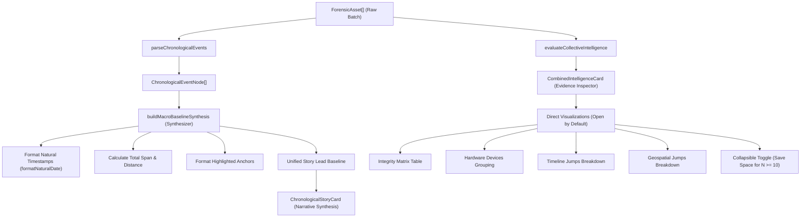

# Blueprint: Batch Macro Narrative Synthesis and Evidence Inspector

This blueprint defines the architecture, public interface contracts, and verification strategy to translate the approved Intent into implementation:
1. Synthesizing session-wide macro conclusions (hardware identity, localized natural date span, and travel distance) into a unified, flowing opening narrative inside `ChronologicalStoryCard`.
2. Repositioning `CombinedIntelligenceCard` as a pure technical evidence inspector that presents data visualizations directly, open by default, with collapsible controls to conserve vertical scrolling space.

## Current Code & Technical Gaps

Currently in the codebase:
1. **`buildBaseline` in `src/core/narratives/chronological.ts`**:
   Only evaluates camera hardware (`devices.length`). It completely ignores timeline duration and geospatial travel distance, even though `ChronologicalEventNode[]` already contains parsed timestamps and coordinate pairs.
2. **`CombinedIntelligenceCard.tsx`**:
   Renders long narrative paragraphs (`narrative.lead`) at the top of each of the four tabs before the user clicks to expand the details. These paragraphs repeat the same information that belongs in the session overview.
3. **Date formatting in `generateCollectiveNarratives` (`src/core/narratives/narratives.ts`)**:
   Uses raw mechanical dates (`DD-MM-YYYY HH:mm:ss`) generated via basic substring slicing or unlocalized formatters, which contrasts sharply with `formatNaturalDate` used in `ChronologicalStoryCard`.
4. **Visualizer accordion default state in `CombinedIntelligenceCard.tsx`**:
   `expandedTabs` is initialized empty (`{}`), requiring users to manually click "Show Detailed ..." to view the inspection data.

## System Architecture & Execution Flow

## Contracts

### BP-SYNTHESIS-001: Unified Macro Baseline Synthesis Engine
- **Serves**: Intent Goal 1 & Goal 2 (Unified macro narrative opening with natural human date formatting).
- **File**: `src/core/narratives/chronological.ts`
- **Input**:
  - `nodes: ChronologicalEventNode[]` (chronologically sorted event nodes).
  - `locale: SupportedLocale` (`'en' | 'id' | 'ar'`).
  - `format: 'html' | 'markdown' | 'plain'`.
- **Behavior**:
  - Extracts hardware device set: single device, multiple devices, or unknown.
  - Extracts timestamp span:
    - Finds first valid timestamp and last valid timestamp among nodes with capture dates.
    - Computes elapsed span in hours/days.
    - Formats start and end dates using `formatNaturalDate(timestamp, locale)`.
  - Extracts geospatial movement:
    - Calculates total path distance across consecutive nodes with valid GPS coordinates using Haversine formula.
  - Combines these facets into a single, cohesive, natural narrative opening paragraph using locale-aware templates (`chrono_macro_baseline_*`).
  - Wraps factual tokens (device name, span hours, formatted start/end dates, total distance) using `formatEvidence(..., format)`.
  - Gracefully adapts when GPS or timestamps are missing (e.g. omits travel distance if no GPS, omits time span if timestamps are missing).
- **Output**: Formatted baseline string (`html`, `markdown`, or `plain`).
- **Failure**: If nodes array is empty or malformed, falls back to neutral fallback string without throwing.
- **Method**: `tdd`
- **Verification**: Unit tests in `tests/core/narratives/chronological.test.ts` covering:
  1. Full session (uniform hardware + time span with natural dates + GPS travel distance).
  2. Multiple devices variation.
  3. Batch without GPS coordinates (time span + hardware only, no distance mention).
  4. Batch without timestamps (hardware + distance only).
  5. Multi-language output (en, id, ar).
- **Commit**: 
  - `test(narratives): add test cases for unified macro baseline with natural date formatting`
  - `feat(narratives): implement unified macro baseline synthesis in chronological story`

### BP-INSPECTOR-002: Evidence Inspector Component Repositioning
- **Serves**: Intent Goal 3 & User Clarification 2 (Direct presentation of visualizations, open by default, collapsible for space saving).
- **File**: `src/components/dashboard/CombinedIntelligenceCard.tsx`
- **Input**: `assets: ForensicAsset[]`, `onInspectAsset?: (assetIndex: number) => void`.
- **Behavior**:
  - Removes the redundant top narrative paragraph (`narrative.lead`) from all tabs.
  - Sets the detailed visualization section to be **open by default** for all tabs (e.g., `expandedTabs` default state evaluates to `true` when not explicitly toggled closed).
  - Updates the toggle button text/state to allow collapsing: "Hide Detailed [Category]" when open, "Show Detailed [Category]" when closed.
  - Renders the custom visualizer component directly under the tab switcher:
    - Tab 0: Status badge summary + full file metadata presence matrix table.
    - Tab 1: Grouped camera hardware list with badge counts.
    - Tab 2: Timeline span summary box + list of chronological jump intervals between photos.
    - Tab 3: Geospatial spread category, furthest spread, total travel distance, and jumps list.
- **Output**: Rendered React JSX element.
- **Failure**: Incomplete metadata fields are handled with neutral fallback badges (`No GPS`, `Unknown Device`) without layout disruption.
- **Method**: `visual testing` & `test-after`
- **Verification**: Verifies in Vitest that the component renders visualizations directly and responds to collapse/expand toggle.
- **Commit**: `feat(dashboard): convert combined analysis card into collapsible evidence inspector`

### BP-I18N-003: Localization Templates for Unified Macro Story and Inspector Controls
- **Serves**: Intent Goal 2 & Boundary constraints (full i18n support across EN, ID, AR).
- **Files**: `src/locales/en.json`, `src/locales/id.json`, `src/locales/ar.json`.
- **Input**: Translation dictionary keys under `narratives` and `ui`.
- **Behavior**:
  - Adds combined macro narrative templates:
    - `chrono_macro_baseline_full`: Single cohesive paragraph combining hardware, formatted start/end dates, span hours, and travel distance.
    - `chrono_macro_baseline_no_gps`: Paragraph combining hardware and formatted timeline span without GPS.
    - `chrono_macro_baseline_no_time`: Paragraph combining hardware and travel distance without timestamps.
  - Adds toggle action keys for inspector:
    - `hide_details`: "Hide Details" / "Sembunyikan Rincian" / "إخفاء التفاصيل"
    - `show_details`: "Show Details" / "Tampilkan Rincian" / "عرض التفاصيل"
- **Output**: Complete localized strings for English, Indonesian, and Arabic.
- **Failure**: Missing translation key falls back to default locale or raw key via `useI18nStore`.
- **Method**: `test-after`
- **Verification**: `tests/store/useI18nStore.test.ts` and template interpolation checks.
- **Commit**: `feat(i18n): add localized templates for macro baseline narrative and inspector controls`

## Non-Goals

- **No deletion of visualizer tables**: Do not remove the matrix table, hardware group list, timeline jump list, or geospatial jump list from `CombinedIntelligenceCard`.
- **No external animation or accordion libraries**: Use existing lightweight CSS transitions and boolean React state; do not install new UI packages (YAGNI).
- **No mixing macro conclusions into step cards**: Individual timeline step items (Step 1, Step 2, Step 3) remain focused solely on transition metrics from image N-1 to image N.
- **No changes to single-asset workflows**: Single-asset inspection tabs and views remain strictly isolated from this batch-level refactoring.
