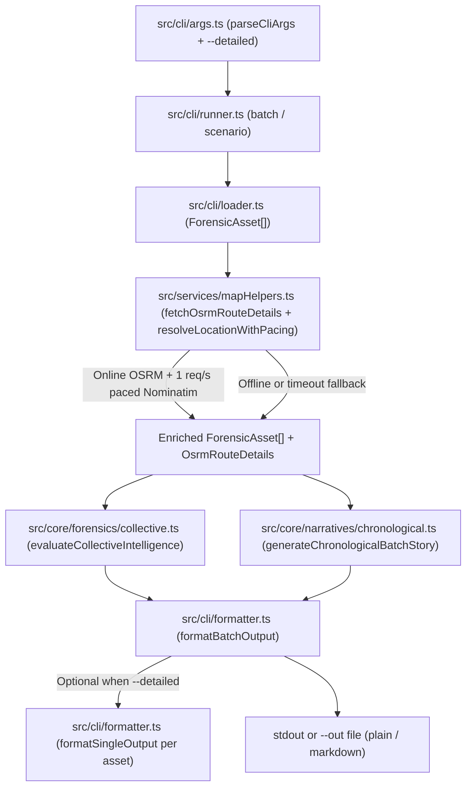

# Blueprint: CLI Batch Analysis Web Parity

This blueprint defines the module boundaries, data flow, technical contracts, and verification plan to align multi-asset CLI output (`exifsense batch <path...>` and batch `exifsense scenario <name>`) 1:1 with the Web batch dashboard (`ChronologicalStoryCard` and `CombinedIntelligenceCard`), plus an opt-in `--detailed` flag for appending per-asset single-file reports.

## Codebase Context and Gaps

In the Web application, batch analysis spans two multi-asset dashboard cards backed by shared core engines and geospatial helpers:

- `src/components/dashboard/ChronologicalStoryCard.tsx` runs sequential coordinate-to-address lookups (reverse geocoding) via OpenStreetMap Nominatim for every geotagged asset lacking `locationData`, fetches road transit distances via OpenStreetMap Routing Machine (OSRM), and renders the unified macro opening (`story.baseline`) followed by numbered chronological steps (`story.steps`).
- `src/components/dashboard/CombinedIntelligenceCard.tsx` acts strictly as a four-part evidence inspector without repeating `generateCollectiveNarratives` paragraphs. It renders the per-file Integrity Completeness Matrix (`collective.integrity.matrix`), the 7-column Hardware Comparison table (`collective.hardware.details`), Timeline capture bounds (`Start of Capture`, `End of Capture` via `formatNaturalDate`, localized duration, time gaps, and `missingAssets`), and Geospatial metrics (`maxSpreadKm`, `totalPathDistanceKm`, `roadRouteDetails`, calculation disclaimers, and sequential location jumps with `via road` leg distances) using adaptive meter/kilometer units.

Comparing `src/cli/runner.ts`, `src/cli/formatter.ts`, and `src/core/` against the Web implementation exposes five concrete gaps:

- `processBatchAssets` in `src/cli/runner.ts` fetches OSRM road route details, but never enriches assets with physical place names via `resolveLocationWithPacing`, so batch `Chronological Story` steps fall back to coordinates instead of street or city names.
- `formatBatchOutput` in `src/cli/formatter.ts` renders `Combined Analysis` before `Chronological Story` and still prints the four legacy summary paragraphs from `generateCollectiveNarratives`, while omitting the per-file Integrity Matrix, the 7-column Hardware table, Timeline capture bounds and `missingAssets`, and Geospatial per-leg jumps and calculation disclaimers.
- `formatBatchOutput` uses hardcoded English section headers, hardcoded `Yes`/`No` and `None detected` strings, English-only `formatDuration` units (`1d 2h 3m 4s`), raw `spreadCategory` keys, and fixed `.toFixed(2) km` formatting instead of `translate()` and adaptive `m`/`km` display.
- `evaluateCollectiveIntelligence` (`src/core/forensics/collective.ts`) and `parseChronologicalEvents` (`src/core/narratives/chronological.ts`) only check `exifData.latitude` and `exifData.longitude` without falling back to `GPSLatitude` and `GPSLongitude` as `runner.ts` and `TimelineMap.tsx` do.
- `src/cli/args.ts` and `src/cli/formatter.ts` have no opt-in `--detailed` flag to include full per-asset breakdowns (`formatSingleOutput`) at the end of a batch report.

## Architecture and Module Boundaries

To keep domain rules pure and preserve clean isolation between filesystem I/O, network calls, and terminal rendering, changes obey four strict boundaries:

- `src/cli/args.ts` parses and validates the `--detailed` option inside the `CliOptions` object at the CLI entry boundary without exposing raw boolean parameter flags inside formatting functions.
- `src/cli/runner.ts` orchestrates all asynchronous network calls (`fetchOsrmRouteDetails` and sequential `resolveLocationWithPacing`) at the execution boundary before calling core domain functions.
- `src/core/` (`collective.ts` and `chronological.ts`) remains pure, synchronous, and network-free, gaining only consistent `GPSLatitude`/`GPSLongitude` coordinate fallback via `isValidCoordinate` logic.
- `src/cli/formatter.ts` stays a pure presentation module reusing `translate()`, `formatNaturalDate()`, and `formatSingleOutput()` rather than duplicating translation dictionaries or single-asset formatting logic.

## Contracts

### BP-BATCH-PARITY-001: `--detailed` CLI Flag Parsing and Option Threading

- **Serves**: Opt-in `--detailed` flag for per-asset reports from Intent
- **Location**: `src/cli/args.ts` and `src/cli/runner.ts`
- **Behavior**: Extend `CliOptions` with `detailed?: boolean` and register `detailed: { type: 'boolean', default: false }` inside `parseArgs` in `src/cli/args.ts`. Populate `options.detailed` cleanly from `Boolean(values.detailed)` for parsed commands and document `--detailed` in `HELP_TEXT` inside `src/cli/runner.ts`.
- **Output**: `CliOptions` containing `detailed: true` when `--detailed` is supplied and `false` by default.
- **Failure**: Unknown or malformed flags continue throwing `CliArgumentError` via `strict: true` argument parsing.
- **Method**: TDD (`method/TDD.md`)
- **Verification**: Unit tests in `tests/cli/cli.test.ts` verifying default `detailed: false`, `--detailed` parsing on `batch` and `scenario` commands, and help output listing `--detailed`.
- **Planned Commits**: `test(cli): add argument parsing tests for --detailed batch flag` followed by `feat(cli): add --detailed option to CLI argument parser and help text`

### BP-BATCH-PARITY-002: Batch Reverse Geocoding Enrichment and Shared GPS Fallback

- **Serves**: Batch coordinate-to-address enrichment with automatic pacing and consistent GPS tag fallback from Intent
- **Location**: `src/cli/runner.ts`, `src/core/forensics/collective.ts`, and `src/core/narratives/chronological.ts`
- **Behavior**: Update `processBatchAssets` in `src/cli/runner.ts` to enrich assets sequentially via `enrichSingleAssetLocation` (which skips assets that already carry `locationName` or `locationData.display_name`, checks `latitude ?? GPSLatitude` and `longitude ?? GPSLongitude` via `isValidCoordinate`, and calls `resolveLocationWithPacing` with automatic 1 req/s spacing, 3000 ms timeout, and in-memory coordinate caching) before running `evaluateCollectiveIntelligence` and `generateChronologicalBatchStory`. In `src/core/forensics/collective.ts` (`evaluateCollectiveIntelligence` presence check and `geoAssets` extraction) and `src/core/narratives/chronological.ts` (`parseChronologicalEvents`), read `exif.latitude ?? exif.GPSLatitude` and `exif.longitude ?? exif.GPSLongitude` and validate both with `isValidCoordinate` so JSON fixtures or partial EXIF payloads containing only `GPSLatitude`/`GPSLongitude` behave identically across `TimelineMap`, `runner.ts`, and `src/core/`.
- **Output**: Enriched `ForensicAsset[]` carrying `locationName` and `locationData` when resolved online, plus accurate GPS counts, coordinates, and distances across `collective` and `story`.
- **Failure**: Offline networks, HTTP errors, invalid coordinates, or timeouts return unchanged assets without throwing, allowing `exifsense batch` to complete with exit code 0 using numeric coordinate fallbacks.
- **Method**: TDD (`method/TDD.md`)
- **Verification**: Unit tests in `tests/core/collective.test.ts` and `tests/core/chronological.test.ts` (or `tests/cli/cli.test.ts`) verifying `GPSLatitude`/`GPSLongitude` fallback, plus integration tests in `tests/cli/cli.test.ts` with mocked `fetch` verifying sequential Nominatim batch enrichment and offline fallback.
- **Planned Commits**: `test(core): verify GPSLatitude/GPSLongitude fallback in collective and chronological engines` followed by `fix(core): fall back to GPSLatitude and GPSLongitude in collective and chronological analysis` and `feat(cli): enrich batch assets sequentially with paced Nominatim reverse geocoding`

### BP-BATCH-PARITY-003: Web-Aligned Batch Section Order, Alerts, and Localization Keys

- **Serves**: Web-aligned section flow, batch anomaly visibility, and full `en`/`id` localization from Intent
- **Location**: `src/cli/formatter.ts`, `src/locales/en.json`, and `src/locales/id.json`
- **Behavior**: Add the small set of missing batch CLI labels to `src/locales/en.json` and `src/locales/id.json` (localized equivalents for `Total Assets`, `Asset Integrity Alerts`, `No integrity anomalies detected.`, `Consistent Hardware`, `Unique Devices`, `None detected`, `Spread Category`, and spread labels for `concentrated`, `localized`, `trail`, and `none`) while reusing all existing Web keys (`chronological_story_title`, `combined_intel`, `analysis_integrity`, `analysis_hardware`, `analysis_timeline`, `analysis_geospatial`, `filter_complete`, `privacy_score_risk`, `filter_stripped`, `reconstruct_*`, `geo_*`, `time_*`, `yes`, `no`, `unknown`). Update `formatBatchOutput` in `src/cli/formatter.ts` to render sections in Web order: Batch Header (`Total Assets`), `Asset Integrity Alerts` when `assetAlerts.length > 0`, `Chronological Story` (`story.baseline` + `Step 1..N`), and then `Combined Analysis`. Remove the four legacy `generateCollectiveNarratives` paragraphs from `formatBatchOutput` so `Combined Analysis` matches `CombinedIntelligenceCard.tsx`.
- **Output**: `plain` or `markdown` batch output following Web order with localized labels and zero duplicate summary paragraphs.
- **Failure**: Missing locale parameters fall back safely to English via `translate()` without throwing.
- **Method**: TDD (`method/TDD.md`)
- **Verification**: Unit tests in `tests/cli/formatter.test.ts` verifying section ordering (`Chronological Story` precedes `Combined Analysis`), absence of legacy `generateCollectiveNarratives` paragraphs, preservation of `Asset Integrity Alerts`, and localized `en` / `id` headers.
- **Planned Commits**: `feat(i18n): add missing batch CLI labels to English and Indonesian locales` followed by `test(cli): update batch formatter unit tests for Web-aligned section order and localization`

### BP-BATCH-PARITY-004: Complete `Combined Analysis` Four-Part Evidence Views

- **Serves**: 1:1 `Combined Analysis` evidence views without redundant narrative paragraphs from Intent
- **Location**: `src/cli/formatter.ts`
- **Behavior**: Render all four structured `Combined Analysis` subsections inside `formatBatchOutput` in both `plain` and `markdown` formats matching `CombinedIntelligenceCard.tsx`. For Integrity Analysis (`analysis_integrity`), display batch counts (`cleanCount`, `partiallyStrippedCount`, `fullyStrippedCount`) alongside a per-file completeness matrix (`File Name`, status label from `filter_complete`, `privacy_score_risk`, or `filter_stripped`, `Device Hardware` using `Make || Model || Unknown`, and `GPS` using localized `yes`/`no`) as a Markdown table in `markdown` mode or aligned rows in `plain` mode. For Hardware Analysis (`analysis_hardware`), display localized `Consistent Hardware` (`yes`/`no`) and `Unique Devices` (with a localized `none detected` fallback), followed by the 7-column hardware comparison table (`File Name`, `Make`, `Model`, `Software`, `Lens Model`, `Body Serial`, `Lens Serial`) from `collective.hardware.details`. For Timeline Analysis (`analysis_timeline`), display `Start of Capture` (`reconstruct_start`) and `End of Capture` (`reconstruct_end`) formatted via `formatNaturalDate(date, locale)` (or `-` when null), `Total Sequence Duration` (`reconstruct_total`) using localized `time_day`, `time_hour`, `time_minute`, and `time_second` units, `Time Gap Between Photos` (`reconstruct_jumps`) listing `fromFileName -> (+delta) toFileName` while keeping `[TIME ANOMALY]` when `deltaDays > 0`, and `Photos Lacking Time Data ({count})` (`reconstruct_missing`) listing `collective.timeline.missingAssets` when non-empty. For Geospatial Analysis (`analysis_geospatial`), format all distance values adaptively (`< 1 km` in rounded meters `m`, `>= 1 km` in `.toFixed(2) km` matching `formatGeoDistance` in `CombinedIntelligenceCard.tsx`), display `Furthest Distance Between Points` (`geo_max_spread`), `Cumulative Displacement` (`geo_reconstruct_range`), `Estimated Road Route` (`geo_estimated_road_route`) when `roadRouteDetails.totalDistanceMeters > 0`, localized `Spread Category`, the calculation method note (`geo_reconstruct_note_road` or `geo_reconstruct_note_displacement`), `[CRITICAL]` velocity anomaly warning when `velocityAlert?.hasAnomaly`, and `Distance Between Locations` (`geo_reconstruct_jumps`) listing each `collective.geospatial.jumps` entry alongside `(~<dist> via road)` when `roadRouteDetails?.legDistancesMeters?.[idx]` is positive.
- **Output**: Complete four-part `Combined Analysis` evidence breakdown matching `CombinedIntelligenceCard.tsx` in both `plain` and `markdown` formats across `en` and `id`.
- **Failure**: Missing timestamps, missing GPS coordinates, or null OSRM route details degrade cleanly (`-`, empty jump lists omitted, straight-line note displayed) without throwing.
- **Method**: TDD (`method/TDD.md`)
- **Verification**: Unit tests in `tests/cli/formatter.test.ts` verifying the Integrity Matrix, 7-column Hardware table, natural-date Timeline bounds + `missingAssets` + localized duration, adaptive `m`/`km` Geospatial output + per-leg `via road` jumps + disclaimers, and Markdown table escaping.
- **Planned Commits**: `feat(cli): align formatBatchOutput Combined Analysis with Web evidence views`

### BP-BATCH-PARITY-005: Opt-In `--detailed` Per-Asset Breakdown and End-to-End Verification

- **Serves**: Opt-in `--detailed` flag for per-asset reports and full batch parity verification from Intent
- **Location**: `src/cli/formatter.ts`, `tests/cli/formatter.test.ts`, and `tests/cli/cli.test.ts`
- **Behavior**: When `options?.detailed` is `true`, append a localized per-asset section (`Individual Asset Analysis` via `ui.individual_analysis`) at the end of `formatBatchOutput` iterating `assets` in input order, prefixing each entry with localized `ASSET {n}: {fileName}` (`reports.asset_header`) and rendering `formatSingleOutput(asset, options)`. When `options?.detailed` is omitted or `false`, do not append per-asset details. Verify end-to-end execution across `exifsense batch`, `exifsense scenario travel-sequence`, `exifsense scenario time-jump-anomaly`, and `exifsense scenario hardware-discrepancy` with `--locale id`, `--format markdown`, `--detailed`, mocked online Nominatim + OSRM, and offline fallback.
- **Output**: Default concise batch report without `--detailed`, or full batch + per-asset report with `--detailed`; passing `npm test`, `npm run typecheck`, and `npm run build:cli` standalone bundle verification.
- **Failure**: Any missing evidence section, unhandled network rejection, or regression in default vs `--detailed` output fails the test suite.
- **Method**: Integration/E2E (`method/INTEGRATION_E2E.md`)
- **Verification**: Run `npm test`, `npm run typecheck`, `npm run build:cli`, and execute `node bin/exifsense.js scenario travel-sequence`, `node bin/exifsense.js scenario travel-sequence --locale id --format markdown`, and `node bin/exifsense.js scenario travel-sequence --detailed`.
- **Planned Commits**: `test(cli): add unit and integration tests for batch Web parity, reverse geocoding, and --detailed`

## Non-Goals

- **No separate `TimelineMap` link block in CLI**: Do not add a text summary of Google Maps or OpenStreetMap URLs, because coordinates and travel routes are already represented in `Chronological Story` and `Combined Analysis`.
- **No changes to Web report exporters**: `src/core/exporter/exporter.ts` (`generateMarkdownReport`, `generatePdfReport`, `generateClipboardReport`, `generateCsvReport`, `generateJsonReport`) remains untouched.
- **No OSRM endpoint flags or local container provisioning**: `--osrm-url` overrides and local OSRM provisioning stay out of scope.
- **No browser DOM or React imports in CLI**: `src/cli/` continues to import strictly from `src/core/`, `src/services/mapHelpers.ts`, and Node built-ins.
