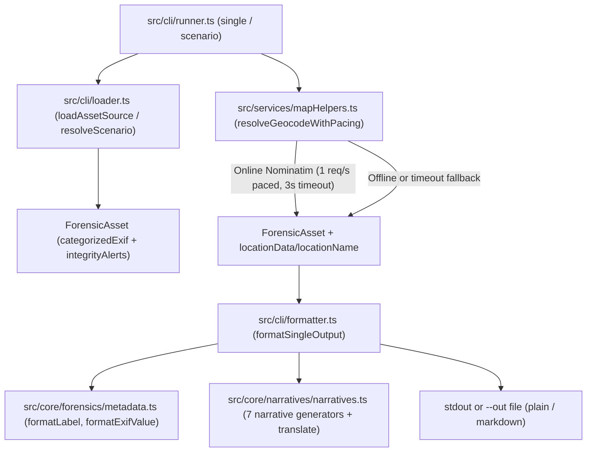

# Blueprint: CLI Single-Asset Web Parity

This blueprint defines the architecture, module contracts, data flow, and verification plan to bring the single-asset CLI execution path (`exifsense single <path>` and single-asset `exifsense scenario <name>`) into 1:1 information parity with the Web single-asset dashboard views (`AssetPreviewCard.tsx` and `ExpertAnalysisTabs.tsx`).

## Codebase Context and Gaps

In the Web application, single-asset presentation spans two main components alongside the shared core domain modules:

- `src/components/dashboard/AssetPreviewCard.tsx` renders file identity details (`File Name`, `File Type`, formatted `File Size`, locale-formatted `File Date`, `SHA-256`, and `SHA-1`).
- `src/components/dashboard/ExpertAnalysisTabs.tsx` renders two major panels: seven forensic narrative tabs (`Standards & Info` / `Integrity Analysis`, `Geospatial`, `Device Hardware`, `Exposure Settings`, `Optics & Lens`, `Image Quality`, and `Timeline & Date`) generated from the full `asset.exifData` dictionary, followed by eight categorized raw EXIF metadata groups (`Device Hardware`, `Exposure Settings`, `Optics & Lens`, `Image Quality`, `Timeline & Date`, `Geospatial`, `Standards & Info`, and `Miscellaneous`) formatted through `formatLabel` and `formatExifValue`.
- `src/services/ingestionCoordinator.ts` and `src/views/DashboardView.tsx` resolve physical place names from GPS coordinates using `reverseGeocode` in `src/services/mapHelpers.ts`, storing `locationData` and `locationName` on the asset.

By contrast, four concrete gaps exist in the current CLI pipeline:

- `src/cli/loader.ts` (`mapRawObjectToAsset` and `loadImageAsset`) and `src/cli/runner.ts` (`executeCommand`) never call `reverseGeocode` and do not preserve `locationName` or `locationData` from JSON fixtures, so `asset.locationName` is always missing in CLI outputs.
- `src/services/mapHelpers.ts` (`reverseGeocode`) uses plain `fetch` without a request timeout, without Node-safe `User-Agent` identification for OpenStreetMap Nominatim, and without sequential rate-limit spacing (pacing).
- `src/cli/formatter.ts` (`formatSingleOutput`) omits `File Date`, uses hardcoded English section headers instead of localized UI strings, passes category slices instead of full `asset.exifData` to narrative generators, checks only numeric `latitude`/`longitude` instead of `GPSLatitude`/`GPSLongitude`, and completely skips the Geospatial narrative when GPS is absent.
- `src/cli/formatter.ts` (`formatSingleOutput`) omits all eight categorized raw EXIF metadata groups even though `categorizeExif` has already populated `asset.categorizedExif` during loading.

## Architecture and Module Boundaries

To keep core domain logic in `src/core/` pure and synchronous without introducing network calls or browser dependencies, all changes follow four strict boundaries:

- `src/services/mapHelpers.ts` owns network calls to OpenStreetMap Nominatim, request timeout safety, Node-compatible headers, in-memory coordinate caching, and sequential rate-limit spacing so the CLI and Web share one coordinate-to-address lookup service.
- `src/cli/loader.ts` remains purely filesystem-based and deterministic: it parses binary images or JSON fixtures, preserves optional `locationName` or `locationData` already present in JSON fixtures, and constructs trusted `ForensicAsset` objects.
- `src/cli/runner.ts` orchestrates network enrichment at the execution boundary for `single` and single-asset `scenario` runs before passing the enriched `ForensicAsset` to the formatter.
- `src/cli/formatter.ts` remains a pure presentation module that formats basic file properties, integrity alerts, all 7 localized forensic narratives, and all 8 localized raw EXIF categories using shared helpers from `src/core/`.

## Contracts

### BP-PARITY-001: Paced Coordinate-to-Address Resolution and Graceful Fallback

- **Serves**: Always-on physical place name lookup with automatic pacing and zero network crashes from Intent
- **Location**: `src/services/mapHelpers.ts`, `src/cli/loader.ts`, and `src/cli/runner.ts`
- **Behavior**: Preserve optional `locationName` and `locationData` fields inside `mapRawObjectToAsset` (`src/cli/loader.ts`) when a JSON fixture already includes them. Export a paced lookup function `resolveLocationWithPacing(lat: number, lng: number)` (or apply sequential pacing inside `src/services/mapHelpers.ts`) that validates coordinates via `isValidCoordinate`, serves cached coordinates immediately from `geocodeCache`, enforces a minimum 1000 ms gap only between consecutive uncached HTTP calls (zero delay for the first uncached request or cache hits), applies a 3000 ms timeout guard, and sends a `User-Agent` header when `typeof window === 'undefined'` to satisfy Nominatim usage requirements in Node.js. In `src/cli/runner.ts`, when running `single` or a single-asset `scenario`, if `asset.locationName` is empty and valid coordinates exist (`asset.exifData?.latitude ?? asset.exifData?.GPSLatitude` and `longitude ?? GPSLongitude`), await the paced lookup and attach `locationData` and `locationName`.
- **Output**: `ForensicAsset` enriched with `locationData` and `locationName` when resolved, or unchanged (`locationName` undefined/null) on offline or error fallback.
- **Failure**: Network errors, HTTP non-2xx responses, invalid JSON, or timeouts return `null` without throwing, allowing `exifsense single` to complete with exit code 0 using coordinate-only fallback text.
- **Method**: TDD (`method/TDD.md`)
- **Verification**: Unit tests in `tests/services/mapHelpers.test.ts` verifying pacing delay on consecutive uncached lookups, zero extra wait on cache hits, and timeout/network failure fallback; integration tests in `tests/cli/cli.test.ts` verifying online Nominatim enrichment and offline fallback in `runCli`.
- **Planned Commits**: `test(geo): add tests for paced Nominatim reverse geocoding and timeout fallback` followed by `feat(cli): enrich single-asset CLI runs with paced reverse geocoding`

### BP-PARITY-002: Basic File Info and Complete 7-Section Narrative Parity

- **Serves**: Full 7-section narrative parity and basic file information parity from Intent
- **Location**: `src/cli/formatter.ts`
- **Behavior**: Update `formatSingleOutput(asset, options)` to render `File Date` formatted with `Intl.DateTimeFormat` for the active locale (`en-US`, `id-ID`, or `ar-SA`, falling back to localized `unknown` from the `reports` namespace) and human-readable file size alongside exact byte size, `File Name`, `Format`, `Dimensions`, `SHA-256`, and `SHA-1` using localized field labels from the `ui` namespace (`file_name`, `file_type`, `file_size`, `file_date`). Render all 7 narrative sections unconditionally in the exact Web tab order: `Integrity Analysis` (`analysis_integrity`), `Geospatial Analysis` (`analysis_geospatial`), `Hardware Analysis` (`analysis_hardware`), `Exposure Analysis` (`analysis_exposure`), `Optics Analysis` (`analysis_optics`), `Quality Analysis` (`analysis_quality`), and `Timeline Analysis` (`analysis_timeline`). Pass the full `asset.exifData` object to each narrative generator, extract coordinates via `exifData.latitude ?? exifData.GPSLatitude` and `exifData.longitude ?? exifData.GPSLongitude`, and pass `NaN` when coordinates are absent or invalid so `generateGeospatialNarrative` always outputs the localized missing-GPS narrative rather than skipping the section.
- **Output**: Formatted `plain` or `markdown` text containing the complete basic file summary, `Integrity Alerts`, and all 7 localized `Forensic Narrative` sections.
- **Failure**: Missing EXIF fields or missing coordinates never omit narrative sections; generators fall back to localized empty-field narratives identically to `ExpertAnalysisTabs.tsx`.
- **Method**: TDD (`method/TDD.md`)
- **Verification**: Unit tests in `tests/cli/formatter.test.ts` verifying `File Date`, section order, localized headings (`en`, `id`, `ar`), full `exifData` forwarding, and explicit Geospatial output when GPS is absent.
- **Planned Commits**: `test(cli): add unit tests for single-asset header and 7-section narrative parity` followed by `feat(cli): align formatSingleOutput file info and 7 narratives with Web`

### BP-PARITY-003: Complete 8-Category Raw EXIF Metadata Output

- **Serves**: Complete 8-category raw EXIF metadata output and explicit empty-category visibility from Intent
- **Location**: `src/cli/formatter.ts`
- **Behavior**: Append a `Categorized EXIF Metadata` section (`--- Categorized EXIF Metadata ---` in `plain` mode, `## Categorized EXIF Metadata` in `markdown` mode) after the 7 forensic narratives inside `formatSingleOutput`. Iterate over all 8 categories in the exact Web order (`Device Hardware` via `cat_hardware`, `Exposure Settings` via `cat_exposure`, `Optics & Lens` via `cat_optics`, `Image Quality` via `cat_quality`, `Timeline & Date` via `cat_timeline`, `Geospatial` via `cat_geospatial`, `Standards & Info` via `cat_standards`, and `Miscellaneous` via `cat_misc`). For categories with tags in `asset.categorizedExif[category]`, format each entry using `formatLabel(key)` and `formatExifValue(key, value, locale)` from `src/core/forensics/metadata.ts` (aligned key-value rows in `plain` mode, Markdown table `| Property | Value |` or bullet list using localized `property`/`value` headers in `markdown` mode). For categories with zero entries, display the category heading followed by `translate('no_metadata_tags', {}, locale, 'narratives')`.
- **Output**: Complete 8-category raw metadata breakdown matching the Web dashboard's categorized inspector in both `plain` and `markdown` formats.
- **Failure**: Missing or undefined category maps in `asset.categorizedExif` default to empty objects and display the localized empty-category message instead of throwing.
- **Method**: TDD (`method/TDD.md`)
- **Verification**: Unit tests in `tests/cli/formatter.test.ts` verifying all 8 category headings appear, populated tags are formatted via `formatLabel`/`formatExifValue`, and empty categories render the localized `no_metadata_tags` string in `en`, `id`, and `ar`.
- **Planned Commits**: `test(cli): add unit tests for 8-category raw EXIF metadata formatting` followed by `feat(cli): render all 8 categorized EXIF metadata groups in single output`

### BP-PARITY-004: End-to-End Single-Asset CLI Parity Verification

- **Serves**: End-to-end verification across `single` and single-asset `scenario` commands
- **Location**: `tests/cli/cli.test.ts`
- **Behavior**: Exercise `runCli(['single', ...])` and `runCli(['scenario', 'missing-gps'])` across `plain`, `markdown`, and `--locale id` configurations with mocked `fetch` responses for both online Nominatim resolution and offline network failure. Verify existing CLI assertions (`=== ExifSense Forensic Analysis ===`, `# ExifSense Forensic Analysis`, `SHA-256`, `--- Forensic Narrative ---`) remain intact alongside the new `File Date`, resolved place names, all 7 narrative sections, and all 8 categorized EXIF sections.
- **Output**: Passing Vitest suite covering all existing and new CLI tests, plus successful `npm run typecheck` and `npm run build:cli` bundle execution.
- **Failure**: Any missing section, unhandled Nominatim exception, or locale regression fails the integration test suite.
- **Method**: Integration/E2E (`method/INTEGRATION_E2E.md`)
- **Verification**: `npm test`, `npm run typecheck`, and `npm run build:cli` followed by running `node bin/exifsense.js scenario baseline` and `node bin/exifsense.js scenario missing-gps --locale id --format markdown`.
- **Planned Commits**: `test(cli): add integration tests for single-asset Web parity and reverse geocoding`

## Non-Goals

- **No batch CLI parity modifications**: `exifsense batch`, `formatBatchOutput`, and batch scenario outputs remain untouched in this Blueprint.
- **No OSRM local provisioning or endpoint override flags**: OSRM container management and `--osrm-url` configuration remain out of scope.
- **No browser DOM or React imports in CLI**: `src/cli/` must never import React components such as `StagedQueue.tsx` or `ExpertAnalysisTabs.tsx`; any small file-size helper needed by the CLI stays self-contained in `src/cli/formatter.ts` unless shared cleanly in `src/core/`.
