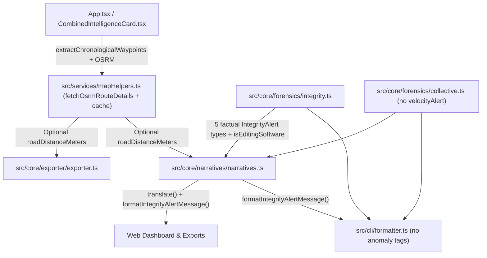

# Blueprint: Factual Narrative Cleanup and Dual-Distance Export Parity

This blueprint specifies the module boundaries, data contracts, template rules, and verification plan to remove legacy manipulation-detection heuristics and dead locale keys, make single-asset and collective narratives strictly factual and localized across English (`en`) and Indonesian (`id`), and surface OSRM dual-distance inside `combined_geo_*` across the Web dashboard and report exporters.

## Current Code

Inspecting the codebase against `docs/intent/20261119_factual_narrative_cleanup_and_dual_distance_parity.md` identifies seven concrete gaps:

- `src/core/forensics/integrity.ts` and `src/core/forensics/types.ts` evaluate six legacy tampering/spoofing alerts (`future_capture_date`, `capture_after_file_modification`, `missing_original_metadata`, `dimension_mismatch`, `null_island`, `integer_coordinate_precision`), gate missing-pillar alerts behind `missingPillars.length >= 2`, count `ModifyDate` as capture date (`hasDateTime`), and omit `GPSLatitude`/`GPSLongitude` fallback in `hasGps`.
- `src/core/forensics/collective.ts`, `src/core/narratives/narratives.ts`, and `src/cli/formatter.ts` compute and render `velocityAlert` (`velocity_warning`, `velocity_anomaly_*`) and `[TIME ANOMALY]` markers on `deltaDays > 0` jumps.
- `src/core/narratives/narratives.ts` returns raw English `alert.defaultMessage` from `generateIntegrityNarrative`, duplicates `EDIT_SOFTWARE` without `'paint.net'`/`'illustrator'`, hardcodes English fallback device strings (`'an unknown manufacturer'`, `'an unspecified device'`), silently fabricates `'Standard'`/`'sRGB'` defaults in `generateQualityNarrative`, and emits speculative prose (`hardware_analysis`, `exp_standard`, `timeline_mod_note`, `timeline_integrity`).
- `src/locales/en.json` and `src/locales/id.json` contain dead `narratives` keys, `en`/`id` asymmetries (`geospatial`, `no_geo`, `combined_integrity_stripped_all`, `combined_hw_consistent`, `combined_hw_discrepancy`, `combined_timeline`, `combined_hw_sparse_consistent`), speculative distance labels (`combined_geo_concentrated`, `combined_geo_localized`, `combined_geo_trail`), a monolithic `quality` template requiring all five fields, and UI copy referring to manipulation heuristics and spoofing.
- `src/core/narratives/narratives.ts` (`generateCollectiveNarratives`) and `src/core/exporter/exporter.ts` (`generateMarkdownReport`, `generateClipboardReport`, `generatePdfReport`) do not accept OSRM road route distances (`totalDistanceMeters`), and `CombinedIntelligenceCard.tsx` never resets `roadRouteDetails` to `null` on asset change, `< 2` waypoints, or offline error.
- `src/services/mapHelpers.ts` lacks a shared chronological waypoint builder (causing `App.tsx` `extractAssetCoordinates` upload order to mismatch `CombinedIntelligenceCard.tsx` chronological order and miss `osrmDetailsCache`), lacks an `AbortController` timeout on `fetchOsrmRouteDetails`, and lacks a synchronous cache reader for clipboard exports.
- `src/cli/formatter.ts` hardcodes `'No integrity anomalies detected.'` when alerts are empty and does not map `IntegrityAlert['type'] === 'editing_software'` to localized `integrity_edit_software`.

## Design

Module boundaries follow five design decisions:

1. Keep `src/core/` pure and network-free: `generateCollectiveNarratives` and `exporter.ts` accept optional already-resolved `roadDistanceMeters?: number | null` inside named structures (`options` object / `ForensicExportMetadata`) rather than calling `fetch` from core modules or using boolean flags.
2. Share chronological waypoint ordering in `src/services/mapHelpers.ts` (`extractChronologicalWaypoints`): both `CombinedIntelligenceCard.tsx` and `App.tsx` sort GPS waypoints identically (`DateTimeOriginal || CreateDate || DateTime`, falling back to `fileDate || 0`) before querying `fetchOsrmRouteDetails` (with 3000 ms `AbortController` timeout) or reading `getCachedOsrmRouteDetails` for synchronous clipboard copy.
3. Unify missing-metadata evaluation and editing-software matching at `src/core/forensics/integrity.ts`: `evaluateSingleAssetIntegrity` emits `missing_gps`, `missing_datetime`, and `missing_device` uniformly whenever 1 or 2 core pillars are absent, exports `isEditingSoftware`, and `narratives.ts` exports `formatIntegrityAlertMessage(alert, locale)` reused by `generateIntegrityNarrative` and `src/cli/formatter.ts`.
4. Preserve `AssetSelectorRibbon.tsx` filtering (`fully_stripped` check) and `generateJsonReport` structural fields except removing `velocityAlert` from `CollectiveIntelligenceResult['geospatial']`.
5. Keep `src/core/sanitizer/` and `SanitizerView.tsx` untouched per ADR-002.

## Contracts

### BP-NARRATIVE-001: Remove Legacy Manipulation Heuristics and Unify Missing-Metadata Alerts

- Serves: Deprecation of 6 legacy integrity alerts and `velocityAlert`, plus uniform factual missing-metadata reporting (Intent #1, #2).
- Input: `SingleAssetInput` in `src/core/forensics/integrity.ts` and `SingleAssetInput[]` in `src/core/forensics/collective.ts`.
- Behavior:
  - Narrow `IntegrityAlert['type']` in `src/core/forensics/types.ts` to `'fully_stripped' | 'missing_gps' | 'missing_datetime' | 'missing_device' | 'editing_software'`.
  - In `src/core/forensics/integrity.ts`, export `isEditingSoftware(software: string): boolean` using `EDITING_SOFTWARE_KEYWORDS` as the single source of truth.
  - Remove the unused `_now` parameter from `evaluateSingleAssetIntegrity(asset: SingleAssetInput)` and remove chronological anomaly checks (`future_capture_date`, `capture_after_file_modification`, `missing_original_metadata`), `dimension_mismatch`, and geospatial spoofing checks (`null_island`, `integer_coordinate_precision`).
  - Align presence checks in `evaluateSingleAssetIntegrity`: use `extractGpsCoordinates(exif) !== null` for `hasGps` and `Boolean(exif.DateTimeOriginal || exif.CreateDate || exif.DateTime)` for `hasDateTime` (excluding `ModifyDate`, matching `collective.ts` and `generateTimelineNarrative`).
  - Remove the `missingPillars.length >= 2` threshold so that whenever `hasAnyExif || hasGps` is true, every absent pillar among `['gps', 'datetime', 'device']` emits its corresponding `missing_*` alert (`severity: 'info'`) with neutral factual `defaultMessage` text (`'GPS coordinates are not recorded in this file.'`, `'Capture date and time are not recorded in this file.'`, `'Device manufacturer, model, and camera settings are not recorded in this file.'`), eliminating `"Selective Metadata Removal"`.
  - Keep `fully_stripped` (`!hasAnyExif && !hasGps`, `'No EXIF metadata was found in this file.'`) and `editing_software` (`'Software tag records "{software}".'`).
  - In `src/core/forensics/types.ts` and `src/core/forensics/collective.ts`, remove `velocityAlert` from `CollectiveIntelligenceResult['geospatial']` and remove the speed/velocity anomaly loop in `evaluateCollectiveIntelligence`.
- Output: `IntegrityAlert[]` containing only factual completeness and `Software` observations, and `CollectiveIntelligenceResult` without `velocityAlert`.
- Failure: Invalid or empty `exifData` yields `fully_stripped` safely without throwing.
- Method: `TDD` (`method/TDD.md`).
- Verification: Update and run `tests/core/forensics/integrity.test.ts` and `tests/core/forensics/collective.test.ts` verifying uniform 1-pillar, 2-pillar, and 3-pillar missing reporting, `GPSLatitude`/`GPSLongitude` and `ModifyDate`-only handling, `editing_software` detection, and absence of removed legacy alert types and `velocityAlert`.
- Commit: `test(forensics): update integrity and collective tests for factual uniform alerts` followed by `refactor(forensics): remove legacy manipulation heuristics and unify missing pillars`.

### BP-NARRATIVE-002: Purely Factual, Localized Single-Asset and Collective Narratives

- Serves: Removal of dead keys, `velocity_warning`, `hardware_analysis`, `exp_standard`, `timeline_mod_note`, and assumption-free localized rewriting across `en.json` and `id.json` (Intent #1, #2, #3).
- Input: `ForensicAsset`, `IntegrityAlert`, EXIF property maps, and `locale` (`'en' | 'id'`) in `src/core/narratives/narratives.ts`.
- Behavior:
  - Export `formatIntegrityAlertMessage(alert: IntegrityAlert, locale: string = 'en'): string` from `src/core/narratives/narratives.ts`, explicitly mapping `'fully_stripped' -> 'integrity_fully_stripped'`, `'missing_gps' -> 'integrity_missing_gps'`, `'missing_datetime' -> 'integrity_missing_datetime'`, `'missing_device' -> 'integrity_missing_device'`, and `'editing_software' -> 'integrity_edit_software'` (passing `{ software: String(alert.messageParam?.software ?? '') }`) via `translate(..., locale)`.
  - Update `generateIntegrityNarrative(asset, locale)` to return localized `integrity_clean` when `asset.integrityAlerts` is empty, or map each alert through `formatIntegrityAlertMessage` joined by `' | '`. Remove `integrity_clean_no_gps`, `integrity_clean_no_datetime`, and `integrity_clean_no_device` branches and keys.
  - Update `generateHardwareNarrative`: replace `EDIT_SOFTWARE` with `isEditingSoftware` imported from `../forensics/integrity`; remove `hardware_analysis`; build `device` from `[Make, Model].filter(Boolean).join(' ')` and rewrite `hardware`/`hardware_mod` to use `{device}` (dropping the hardcoded English `'an unknown manufacturer'`/`'an unspecified device'` fallbacks and avoiding `"an {make}"` article collisions); when both `Make` and `Model` are empty while `LensModel` or `Software` is present, use dedicated camera-omitted templates (`hardware_no_device` / `hardware_mod_no_device`); when `Make`, `Model`, `LensModel`, and `Software` are all absent, return localized `no_hardware_narrative`; update `hardware_software` to report neutrally that the `Software` tag records `{software}`.
  - Update `generateExposureNarrative`: remove `exp_standard`; when `FNumber`, `ApertureValue`, `ExposureTime`, and `ISO` are all absent, return localized `no_exposure_narrative`; when any exposure parameter is present, emit the base parameter sentence and append only matched notes (`exp_shallow_depth`, `exp_low_light`, `exp_bright`).
  - Update `generateQualityNarrative`: remove the monolithic `quality` template and silent `'Standard'` / `'sRGB'` fallbacks; when `ImageWidth`/`PixelXDimension`, `ImageHeight`/`PixelYDimension`, `Contrast`, `Sharpness`, and `ColorSpace` are all absent, return localized `no_quality_narrative`; otherwise assemble and join factual sentences solely from whichever properties are actually present in `props` using modular keys (`quality_resolution` when both width and height are present, `quality_contrast` when `Contrast` is non-empty, `quality_sharpness` when `Sharpness` is non-empty, and `quality_color_space` when `ColorSpace` is non-empty).
  - Update `generateTimelineNarrative`: remove `ModifyDate` divergence branching, `timeline_mod_note`, and `timeline_integrity`, outputting only `timeline_capture`, `timeline_format`, and `timeline_gmt` (or `no_chrono` when capture date is absent).
  - Update `generateGeospatialNarrative`: remove `"The location data appears natural and genuine."` from `geospatial` in `en.json`, and rewrite `no_geo` in both `en.json` and `id.json` to state factually that no GPS coordinate tags exist in the file.
  - Remove `velocity_warning` handling from `generateCollectiveNarratives`.
  - Complete `src/locales/en.json` and `src/locales/id.json` (`narratives`) inventory:
    - **Repurpose (5 existing unused keys, rewritten neutrally)**: `integrity_edit_software`, `integrity_fully_stripped`, `integrity_missing_gps`, `integrity_missing_datetime`, `integrity_missing_device`.
    - **Delete (21 remaining original dead keys + 3 replaced `integrity_clean_no_*` + 6 retired/replaced narrative keys = 30 keys)**: `integrity_future_date`, `integrity_capture_after_file`, `integrity_missing_original`, `integrity_dimension_mismatch`, `sanitization_alert`, `null_island_warn`, `precision_warn`, `combined_hw_sparse_single`, `combined_hw_sparse_discrepancy`, `combined_timeline_sparse_note`, `combined_geo_sparse`, `combined_geo_sparse_note`, `combined_integrity_warning`, `combined_integrity_stripped_part`, `empty_geospatial`, `empty_hardware`, `empty_exposure`, `empty_optics`, `empty_quality`, `empty_timeline`, `empty_all`, `integrity_clean_no_gps`, `integrity_clean_no_datetime`, `integrity_clean_no_device`, `hardware_analysis`, `exp_standard`, `quality`, `timeline_mod_note`, `timeline_integrity`, `velocity_warning`.
    - **Add (new factual keys)**: `hardware_no_device`, `hardware_mod_no_device`, `no_hardware_narrative`, `no_exposure_narrative`, `no_quality_narrative`, `quality_resolution`, `quality_contrast`, `quality_sharpness`, `quality_color_space`, `geo_dual_road_clause`, `combined_geo_spread_only`.
    - **Rewrite identically across `en.json` and `id.json` without assumptions**: `integrity_clean`, `hardware`, `hardware_mod`, `hardware_software`, `geospatial`, `no_geo`, `combined_integrity_stripped_all`, `combined_hw_consistent`, `combined_hw_discrepancy`, `combined_hw_sparse_consistent`, `combined_timeline`, `combined_geo_concentrated`, `combined_geo_localized`, `combined_geo_trail`.
- Output: Plain-text localized narratives matching `en` and `id` without assumptions, silent tag fabrication, or English `defaultMessage` leaks.
- Failure: Unsupported locale falls back safely to `'en'` via `translate()`.
- Method: `TDD` (`method/TDD.md`).
- Verification: Update and run `tests/core/narratives/single_narratives.test.ts`, `tests/core/narratives/exposure_narratives.test.ts`, `tests/core/narratives/timeline_narratives.test.ts`, and `tests/core/narratives/collective_narratives.test.ts` verifying Indonesian and English outputs, missing-quality/exposure/hardware handling, and absence of removed assumptions.
- Commit: `test(narratives): update narrative tests for factual localized output` followed by `feat(narratives): localize alerts and strip assumptive templates and fallbacks`.

### BP-NARRATIVE-003: Dual-Distance OSRM Support in Collective Narratives, Web Dashboard, and Exporters

- Serves: Transparent dual-distance inside `combined_geo_*` across Web and Exports without network calls in `src/core/` or new export sections (Intent #5, Non-Goals #2, #3).
- Input: `generateCollectiveNarratives(collective, totalAssets, locale = 'en', options?: { roadDistanceMeters?: number | null })`, `ForensicExportMetadata.roadDistanceMeters?: number | null` in `src/core/exporter/types.ts`, `src/services/mapHelpers.ts`, and `src/App.tsx`.
- Behavior:
  - In `src/services/mapHelpers.ts`:
    - Export `extractChronologicalWaypoints(assets: ForensicAsset[]): MapWaypoint[]` using `extractGpsCoordinates` / `isValidCoordinate` and sorting chronologically by `parseExifDate(DateTimeOriginal || CreateDate || DateTime)?.getTime() ?? asset.fileDate ?? 0` (matching `CombinedIntelligenceCard.tsx`).
    - Add `timeoutMs?: number` (default `3000`) with `AbortController` to `fetchOsrmRouteDetails(waypoints, options?: { timeoutMs?: number })` using `createAbortTimeout` so hanging networks abort cleanly instead of blocking exports.
    - Export `getCachedOsrmRouteDetails(waypoints: Array<{ lat: number; lng: number }>): OsrmRouteDetails | null` for synchronous cache lookup without issuing a network request.
  - In `generateCollectiveNarratives` (`src/core/narratives/narratives.ts`), format adaptive straight-line distance cleanly (`< 1 km` as rounded `{m} m`; `>= 1 km` as `${km.toFixed(1).replace('.0', '')} km`, matching `chronological.ts:formatDistance`). When `collective.geospatial.totalPathDistanceKm > 0`, build `roadClause` by prepending `' '` to `translate('geo_dual_road_clause', { roadDist }, locale)` (`"(atau ~{roadDist} melalui rute jalan OSRM)"` / `"(or ~{roadDist} via OSRM road route)"`, keeping the leading space outside `translate()` so `.trim()` never removes it) when `options?.roadDistanceMeters != null && options.roadDistanceMeters > 0` (else `''`), and embed `{dist}{roadClause}.` inside `combined_geo_localized` and `combined_geo_trail` so offline sentences never leave a trailing space before the period. When `spreadCategory` is `'localized'` or `'trail'` while `totalPathDistanceKm === 0` (geotagged photos lacking EXIF timestamps in `collective.ts`), render `combined_geo_spread_only` reporting `maxSpreadKm` straight-line spread instead of printing `0 m`/`0 km`.
  - In `src/components/dashboard/CombinedIntelligenceCard.tsx`: replace inline sorting with `extractChronologicalWaypoints(assets)`; reset `setRoadRouteDetails(null)` on `assets` change, when `waypoints.length < 2`, and on failed/null OSRM response; pass `{ roadDistanceMeters: roadRouteDetails?.totalDistanceMeters ?? null }` to `generateCollectiveNarratives`.
  - In `src/core/exporter/types.ts` and `src/core/exporter/exporter.ts`: add `roadDistanceMeters?: number | null` to `ForensicExportMetadata` and thread `{ roadDistanceMeters: meta.roadDistanceMeters ?? null }` into `generateCollectiveNarratives` inside `generateMarkdownReport`, `generateClipboardReport`, and `generatePdfReport` without altering export section headings or order.
  - In `src/App.tsx` (`handleExport`): when `assets.length > 1`, compute `waypoints = extractChronologicalWaypoints(assets)`. If `waypoints.length >= 2`, for `'pdf'` and `'md'` resolve `roadRouteDetails = await fetchOsrmRouteDetails(waypoints, { timeoutMs: 2500 })` (falling back to `null` on error), and for `'clipboard'` read synchronously via `getCachedOsrmRouteDetails(waypoints)` so `navigator.clipboard.writeText()` preserves transient user activation across browsers; attach `roadDistanceMeters: roadRouteDetails?.totalDistanceMeters ?? null` to `meta`.
- Output: Identical chronological waypoint ordering and dual-distance geospatial narrative in `CombinedIntelligenceCard` and exported PDF, Markdown, and Clipboard reports when online, degrading deterministically to straight-line displacement alone offline.
- Failure: OSRM network timeout (2500–3000 ms) or offline error yields `roadDistanceMeters: null` without blocking download or clipboard copy.
- Method: `TDD` (`method/TDD.md`) for `narratives.ts`, `mapHelpers.ts`, and `exporter.ts`, plus `Integration/E2E` (`method/INTEGRATION_E2E.md`) for export wiring.
- Verification: Add tests in `tests/services/mapHelpers.test.ts`, `tests/core/narratives/collective_narratives.test.ts`, and `tests/core/exporter/` verifying chronological waypoint ordering, OSRM timeout/cache helpers, and online (`roadDistanceMeters` provided) vs offline (`null`) `combined_geo_*` output across Markdown, Clipboard, and PDF exports, plus run `npm run typecheck` and `npm run build`.
- Commit: `test(exporter): add dual-distance OSRM and waypoint ordering tests` followed by `feat(exporter): thread chronological OSRM road distance into collective narratives and exports`.

### BP-NARRATIVE-004: Align CLI Formatter and Web UI Copy With Descriptive Scope

- Serves: Removal of CLI anomaly tags (`time_anomaly_tag`, `velocity_anomaly_*`) and legacy manipulation wording in `ui` locale keys (Intent #1, #4).
- Input: `src/cli/formatter.ts`, `src/locales/en.json`, and `src/locales/id.json`.
- Behavior:
  - In `src/cli/formatter.ts`: Remove `time_anomaly_tag` prefixing on `deltaDays > 0` jumps; remove the `velocityAlert?.hasAnomaly` block in `appendGeospatialEvidenceSection`; translate every alert in `formatSingleOutput` and `appendBatchAlerts` through `formatIntegrityAlertMessage(alert, locale)` from `../core/narratives/narratives`; localize the empty-alerts line in `formatSingleOutput` using `translate('no_integrity_anomalies', {}, locale, 'ui')`.
  - In `src/locales/en.json` and `src/locales/id.json` (`ui`): Remove `time_anomaly_tag`, `velocity_anomaly_label`, and `velocity_anomaly_desc`; update `no_integrity_anomalies` to neutral completeness phrasing (`"No missing core metadata or editing software tags noted."` / `"Tidak ada catatan kekurangan metadata inti maupun tag perangkat lunak penyunting."`); update `hero_subtitle`, `dropzone_subtitle_single`, `feature_integrity_desc`, `guide_feat_integrity_desc`, `feature_spoof_title`, and `guide_feat_spoof_title` to remove manipulation heuristics, tampering, and spoofing claims while preserving layout slot lengths (`HomeView.tsx`, `GuideView.tsx`).
- Output: Clean localized CLI single and batch output free of legacy anomaly labels, and Web UI copy aligned with the thesis scope.
- Failure: Missing locale falls back safely to `'en'`.
- Method: `TDD` (`method/TDD.md`) for `cli/formatter.ts` and `Test-After` (`method/TEST_AFTER.md`) / build verification for UI copy keys.
- Verification: Update and run `tests/cli/formatter.test.ts` and `tests/cli/cli.test.ts`, run full `npm test`, `npm run typecheck`, and `npm run build` (including `npm run build:cli`), and verify `node bin/exifsense.js scenario travel-sequence --locale id` and `node bin/exifsense.js scenario time-jump-anomaly`.
- Commit: `refactor(cli): remove legacy anomaly labels and localize alerts` followed by `docs(i18n): align Web UI copy with descriptive metadata scope`.

## Non-Goals

- Do not include speculative assumptions (user intent, photographer identity, transport mode, or authenticity verdicts) in any template, quality/hardware fallback, or alert message.
- Do not make network requests inside `src/core/`; `narratives.ts` and `exporter.ts` only consume optional pre-fetched OSRM distance data.
- Do not add new sections to `exporter.ts` reports.
- Do not remove or alter `src/core/sanitizer/` or `SanitizerView.tsx` (preserved for Web per ADR-002).
- Do not implement `--osrm-url` or `OSRM_URL` CLI endpoint overrides in this Blueprint (tracked separately under ADR-001).
